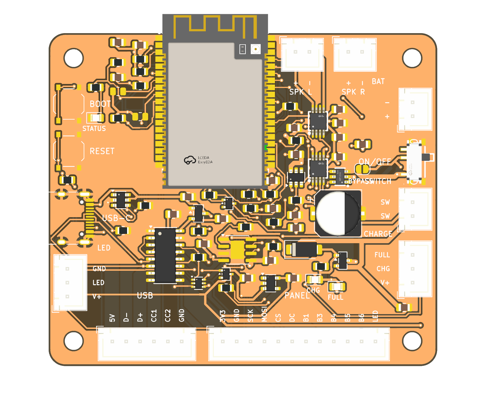
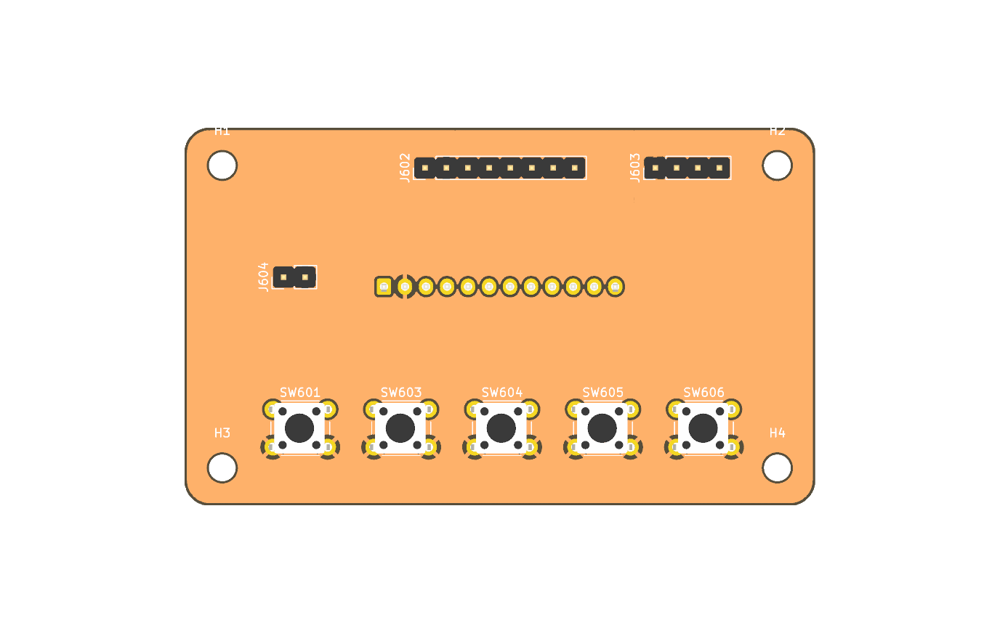
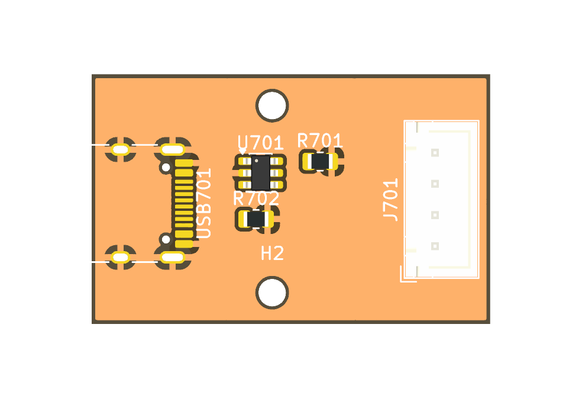

# Custom PCB — Rev A (in design)

A battery-powered board set for the Sendspin speaker, replacing the
ESP32-Audio-Kit. It keeps the Audio Kit's pins wherever it can — the SPI
screen even stays on the same pins — so the firmware carries over as
`speaker-diy.yaml` with only the battery, charge and LED parts added.
KiCad 10 projects; the hardware is licensed under CERN-OHL-P-2.0
([LICENSE](LICENSE)), the firmware in the repo root under MIT.

> Status: all schematics drawn (ERC clean). **Main board placed, routed
> (Freerouting) and labelled**, DRC without errors, JLC files can be made.
> Front panel and USB-C board placed, not routed yet. Before ordering: check
> the NS4150B values and the part rotations (see *Open checks*). Nothing
> built or tested.

| Main board, 70 × 60 mm | Front panel, 75 × 45 mm | USB-C board, 32 × 22 mm |
|---|---|---|
|  |  |  |

Reference designators are numbered per sheet: MCU 1xx, Power 2xx, USB 3xx,
Audio 4xx, Connectors 5xx (front panel and USB-C board: 6xx, 7xx).

## Highlights

- **Three boards**: the main board with module, audio and power; a front
  panel with the display and the five buttons; a small USB-C board.
  Everything that sits in the enclosure wall — panel, USB-C, battery,
  speakers, status LED, on/off switch, charge LEDs — connects by JST cable,
  so the main board can go anywhere in the case.
- **USB-C either way**: on the main board directly, or on the USB-C board
  through a cable. Both footprints are on the main board; fit one.
- **SPI or I²C display**: the panel connector carries SCK/SCL, MOSI/SDA, CS
  and DC, so it takes the ST7789 the Audio Kit build uses (same pins), or
  an SSD1306/SH1106 OLED on the first two lines.
- **ESP32-A1S (Ai-Thinker, ES8388 version)**, the same module as the Audio
  Kit, hand-soldered (JLC doesn't stock it). Antenna over the board edge or
  a cutout; the footprint carries a copper keepout under it.
- **Stereo, 2 × 3 W**: two NS4150B in BTL into 4 Ω, powered straight from
  the battery, enabled together on GPIO21.
- **1S LiPo** with TP4056 charging (~500 mA, so any PC port works),
  DW01A + FS8205A protection, load sharing, red/green charge LEDs that the
  firmware can read too.
- **One USB-C port** for charging and flashing (CH340C with auto-reset).
- **On/off switch after the charger**: the battery still charges while the
  speaker is off.
- **0805 wherever possible** for resistors, capacitors and LEDs, so
  everything can be hand-soldered and reworked.

## Boards

| Board | KiCad project | Carries |
|---|---|---|
| Main | [`main/`](main/) | ESP32-A1S, amps, charger and protection, regulators, CH340C, Boot/Reset, on-board options for switch and charge LEDs, all connectors below |
| Front panel | [`ui/`](ui/) | buttons 1, 3, 4, 5, 6 and headers only (SPI and I²C display, status LED): any panel wiring can replace it |
| USB-C | [`usb/`](usb/) | USB-C receptacle only: any USB-C breakout or panel socket can replace it |

## Connectors (main board)

JST XH (2.5 mm) unless noted. Pin 1 first.

| Ref | To | Pins | Signals |
|---|---|---|---|
| J_UI | front panel | XH 12 | 3V3, GND, SCK/SCL (14), MOSI/SDA (13), CS (15), DC (22), BTN1 (36), BTN3 (19), BTN4 (23), BTN5 (18), BTN6 (5), LED (12, through R501 330 Ω) |
| J_USB | USB-C board | XH 6 | VBUS, D−, D+, CC1, CC2, GND |
| USB1 | — | USB-C 16-pin | the on-board option, in parallel with J_USB |
| J_BAT | LiPo cell | XH 2 | BAT+, BAT− |
| J_SW | on/off switch | XH 2 | VBAT_LS, VBAT_SW (switch in series) |
| J_CHG | charge LEDs | XH 3 | LED+ (VBUS), CHRG (red cathode), STDBY (green cathode) |
| J_LED | status LED | XH 3 | VBAT_SW, LED (12) through 330 Ω, GND |
| J_SPK_L | left speaker | XH 2 | OUTP, OUTN |
| J_SPK_R | right speaker | XH 2 | OUTP, OUTN |

- **Speakers are bridged (BTL)**: neither wire is ground. Never tie a
  speaker wire to GND or share a return between the two speakers.
- **Battery on JST XH** like every other cable: most cells ship with a PH
  plug, so crimp an XH plug on (or use an adapter lead). Cells differ in
  polarity: check before plugging in. Silkscreen `+`/`−` at the connector.
- **J_UI**: a SPI display uses all four display lines; an I²C OLED only
  SCK/SCL and MOSI/SDA, with the two 4.7 kΩ pull-ups on the main board
  fitted (leave them off for SPI). GPIO36's 10 kΩ pull-up is on the main
  board too, so the panel has nothing but buttons to GND and headers.
  Keep the cable short (≤ 20 cm). The LED pin is GPIO12 after R501
  (330 Ω), so a panel LED wires straight on.
- **J_USB / USB1**: the 5.1 kΩ CC resistors (R301/R302) and the USBLC6-2SC6
  are on the main board and serve both, so the off-board side is a bare
  receptacle: our USB-C board or any breakout that brings out VBUS, D−, D+,
  CC1, CC2 and GND (leave R301/R302 off if it has its own 5.1 kΩ). Fit
  either USB1 or J_USB, not both. The cable carries charge and
  load current (amps on battery through load sharing), so XH's 3 A per pin
  is plenty; keep it short (≤ 15 cm) for USB full speed.
- **J_SW**: the switch goes in series between load sharing and VBAT_SW.
  Fit either the on-board MSK12C02 or J_SW with a panel switch; with
  neither, bridge the solder jumper next to them.
- **J_CHG**: the LED resistors stay on the main board; the on-board 0805
  LEDs are in parallel and can be left off.
- **J_LED**: GPIO12 goes out through R501 (330 Ω), so a plain LED wires
  straight to LED/GND; VBAT_SW is there for an SK6812-type LED (needs
  > 3.7 V, hence not 3V3; R501 is its data series resistor). The on-board
  LED (D101/R108) stays as well.

## Parts and footprints

Footprints are set on the symbol the moment it is placed. KiCad's own
library where it has the part; otherwise imported from LCSC into
`lib/lcsc` (see [Libraries](#libraries)).

| Block | Part | Footprint | LCSC |
|---|---|---|---|
| Module | ESP32-A1S (ES8388), hand-soldered | `lcsc:WIRELM-SMD_ESP32-A1S` (+ antenna keepout) | C277945 |
| Amps | 2 × NS4150B | `lcsc:MSOP-8_L3.0-W3.0-P0.65-LS5.0-BL` | C189961 |
| Bulk | 470 µF, ≥ 6.3 V | `Capacitor_SMD:CP_Elec_8x10` | |
| Charger | TP4056 | `Package_SO:SOIC-8-1EP_3.9x4.9mm_P1.27mm_EP2.41x3.3mm` | |
| Protection | DW01A | `Package_TO_SOT_SMD:SOT-23-6` | |
| | FS8205A | `lcsc:SOT-23-6_L2.9-W1.6-P0.95-LS2.8-BR` | C2830320 |
| Load sharing | AO3401A | `Package_TO_SOT_SMD:SOT-23` | |
| | SS34 | `Diode_SMD:D_SMA` | |
| Power switch | MSK12C02 | `lcsc:SW-TH_MSK12C02` | C431540 |
| Switch bypass | solder jumper JP201 | `Jumper:SolderJumper-2_P1.3mm_Open_RoundedPad1.0x1.5mm` | |
| Charge status | 2 × BAT54W (GPIO isolation) | `Package_TO_SOT_SMD:SOT-323_SC-70` | |
| 3.3 V | AP2112K-3.3 | `Package_TO_SOT_SMD:SOT-23-5` | |
| 3.3 V (CH340C) | XC6206P332MR | `Package_TO_SOT_SMD:SOT-23-3` | |
| USB-UART | CH340C | `Package_SO:SOIC-16_3.9x9.9mm_P1.27mm` | |
| Auto-reset | UMH3N | `Package_TO_SOT_SMD:SOT-363_SC-70-6` | |
| ESD | USBLC6-2SC6 | `Package_TO_SOT_SMD:SOT-23-6` | |
| USB-C | 16-pin receptacle | `Connector_USB:USB_C_Receptacle_HRO_TYPE-C-31-M-12` | |
| Boot, Reset | tactile 5.1 × 5.1 mm | `Button_Switch_SMD:SW_Push_1P1T_XKB_TS-1187A` | |
| Panel buttons | tactile 6 × 6 mm THT | `Button_Switch_THT:SW_PUSH_6mm` | |
| Display headers | 1 × 8 (SPI), 1 × 4 (I²C) | `Connector_PinHeader_2.54mm:PinHeader_1x08/1x04_P2.54mm_Vertical` | |
| JST XH | B*B-XH-A vertical | `Connector_JST:JST_XH_B<n>B-XH-A_1x<n>_P2.50mm_Vertical` | |
| R, C, LED | | `Resistor_SMD:R_0805_2012Metric`, `Capacitor_SMD:C_0805_2012Metric`, `LED_SMD:LED_0805_2012Metric` | |

LCSC numbers for the KiCad-library parts are filled in when they go into
the schematic (field `LCSC`), for JLC assembly.

**0805** for resistors, capacitors and LEDs wherever the part exists in
it. Exceptions: the bulk capacitor, and values that don't come in 0805 at
the needed voltage (check 22 µF for ≥ 10 V rating and DC-bias derating).

**Values and wiring notes**

- TP4056: R_PROG 2.4 kΩ (~500 mA). CHRG/STDBY reach GPIO4/GPIO2 through
  BAT54W diodes (cathode at the TP4056): the LEDs hang off VBUS, and without
  the diodes 5 V would leak into the GPIOs — and GPIO2 high at reset would
  stop USB flashing.
- CH340C: own XC6206 3.3 V from VBUS (USB only, no battery drain), V3 tied
  to VCC, TX/RX through 470 Ω. Auto-reset DTR/RTS → EN/GPIO0; EN 10 kΩ
  pull-up + 1 µF. GPIO0 is also the codec's MCLK, as on the Audio Kit.
- USB-C: 5.1 kΩ on CC1 and CC2 separately; A6/B6 and A7/B7 tied.
- Module: 22 µF + 100 nF at 3V3.
- NS4150B: inputs from the module's differential speaker outputs through
  100 nF + 100 kΩ per leg (gain = 240 kΩ / Rin = 2.4, −3 dB at 16 Hz; 47 kΩ
  gives 5.1 if it's too quiet), Bypass 1 µF, supply 10 µF + 1 µF (the
  datasheet's 1 µF instead of 100 nF), R421 100 kΩ pull-down on AMP_EN so
  the amps stay off while booting.
- No headphone output (owner, 2026-10-30): the module's HPOUTL/R are left
  open; GPIO39 (the Audio Kit's headphone detect) keeps its 10 kΩ pull-up
  and is spare.
- Front panel: no parts besides buttons and headers. ST7789 RST tied to
  3.3 V (the driver sends a software reset), backlight always on; J604
  takes a status LED directly.
- Battery sense: 2 × 470 kΩ + 100 nF on the **cell** (VBAT) → GPIO34, ~4.5 µA.
  Not on VBAT_SW: with USB in, load sharing puts ~4.6 V from VBUS there and
  the cell couldn't be measured while charging.
- Protection sits in the negative lead: BAT_N is the cell's minus, GND
  the protected system ground (P−). DW01A: 100 Ω / 100 nF supply, CS via 1 kΩ.
- Load sharing: SS34 from VBUS to the load (VBAT_LS); AO3401A with drain
  at the cell, source at the load, gate on VBUS (100 kΩ to GND), so it
  connects the cell only without USB.
- AP2112K-3.3: 10 µF in and out, EN tied to VIN.
- Flashing over USB needs the switch on.

## Open checks

- **NS4150B values**: Rin/Cin from the gain formula; the typical
  application page of the datasheet wasn't readable either — compare.
- **Part rotations** in JLC's placement preview: KiCad and JLC disagree on
  some footprints' zero orientation (SOT-23, SOIC, USB-C).

## Pin plan

The ESP32-A1S keeps the codec's I²C (GPIO32/33) and I²S (25/26/27/35)
inside the module; they are not on its pads. The free pads are GPIO 0, 2,
4, 5, 12, 13, 14, 15, 18, 19, 21, 22, 23, 34, 36, 39 and TX/RX.

| Function | GPIO | Same as Audio Kit? |
|---|---|---|
| Codec I²C / I²S | 32/33, 25/26/27/35 + MCLK 0 | yes, inside the module |
| Display SCK/SCL, MOSI/SDA, CS, DC | 14, 13, 15, 22 | yes (the ST7789's pins; its reset on 12 is dropped) |
| Amp enable | 21 | yes |
| Buttons 1 play/pause, 3 prev, 4 next, 5 vol −, 6 vol + | 36, 19, 23, 18, 5 | yes; 36 needs an external 10 kΩ pull-up |
| Spare (was headphone detect) | 39 | 10 kΩ pull-up kept; input only |
| Status LED | 12 | new; 10 kΩ pull-down keeps the strap low at boot |
| CHRG / STDBY | 4 / 2 | new; through BAT54W, internal pull-ups |
| Battery ADC | 34 | new |
| UART (CH340C) | 1 / 3 | yes |

Strapping pins: GPIO12 must be low at reset (else 1.8 V flash, no boot),
GPIO2 low or floating for USB flashing, GPIO15 high (CS's pull-up keeps it
so). All pads are in use.

## Firmware changes (`speaker-diy.yaml`, later)

- Display: keep the ST7789 config without `reset_pin`, or switch to
  `ssd1306_i2c` with `i2c: sda: 13, scl: 14` (a second bus; the codec's
  stays on 33/32) and a monochrome UI.
- Battery `adc` on GPIO34 (12 dB, ×2, cell voltage); warn below 3.5 V (LDO).
- Status LED on GPIO12.
- *Charging* / *Charged* binary sensors on GPIO4/GPIO2 (pull-up): charging =
  CHRG low and STDBY high, charged = STDBY low and CHRG high; anything else
  means no USB (without VBUS both can read low through the TP4056).

## Libraries

- KiCad 10's standard libraries for everything they have.
- `lib/lcsc.*`: the five parts KiCad doesn't have, imported from LCSC's
  EasyEDA library with [easyeda2kicad](https://github.com/uPesy/easyeda2kicad.py)
  (symbol, footprint, STEP model). Afterwards: 3D paths point at
  `${KIPRJMOD}/../lib/lcsc.3dshapes/`, the locating pegs of MSK12C02 and
  PJ-320D are non-plated, the A1S got an antenna keepout and a courtyard
  around its pads, the PJ-320D a courtyard (it had none) and its 3D model
  moved 7.6 mm onto its pads, and MSK12C02 is marked SMD. Check every
  imported part's courtyard and 3D model before using it.
  See [THIRD_PARTY_NOTICES.md](../THIRD_PARTY_NOTICES.md).
- `lib/sendspin-speaker.*`: parts we draw ourselves (none yet).

To import another part: `easyeda2kicad --full --lcsc_id C… --output
<scratch>/lcsc`, check it, then merge it into `lib/lcsc.*` with the same
fixes.

## Layout

```
main/sendspin-speaker-main.kicad_*   main board; the top sheet is the block diagram
main/usb.kicad_sch                   USB-C, ESD, CH340C, auto-reset
main/power.kicad_sch                 charger, protection, load sharing, switch, 3V3, battery sense
main/mcu.kicad_sch                   ESP32-A1S, Boot/Reset, status LED, pull-ups
main/audio.kicad_sch                 2x NS4150B, speaker connectors
main/connectors.kicad_sch            J_UI (front panel), J_LED
ui/sendspin-speaker-ui.kicad_*       front panel
usb/sendspin-speaker-usb.kicad_*     USB-C board
*/sym-lib-table, */fp-lib-table      each project points at ../lib/ only
lib/lcsc.kicad_sym, .pretty/, .3dshapes/   parts imported from LCSC
lib/sendspin-speaker.kicad_sym, .pretty/   parts we draw ourselves
scripts/schgen.py, make_*.py         draft generator for a sheet's first version
scripts/pcbplace.py, place_*.py      board placement (KiCad's Python)
scripts/route.py                     autorouting with Freerouting
scripts/silk_main.py                 silkscreen labels
scripts/lcsc_fields.py, jlc.py       LCSC numbers; JLC Gerbers, BOM, CPL
docs/*.png                           3D renders of the boards
```

`scripts/` writes the first draft of a sheet (symbols copied from the
libraries, footprints set, pins wired to labels on the 1.27 mm grid) and the
first placement of a board (`D:/Programs/KiCad/10.0/bin/python.exe
hardware/scripts/place_main.py`, KiCad closed). Once a sheet or board has
been edited in KiCad, it is never regenerated. Symbol UUIDs are derived from
sheet + reference, so a regenerated sheet stays linked to its footprints.

## PCB

| | Main | Front panel | USB-C |
|---|---|---|---|
| Size | 70 × 60 mm | 75 × 45 mm | 32 × 22 mm |
| Corners | rounded, r = 3 mm | r = 3 mm | r = 2 mm |
| Holes | 4 × M3, 4.5 mm in from both edges (screw heads stay on the board) | 4 × M3, same | 2 × M2, 3 mm in |
| Layers | 2, GND pour on both | 2 | 2 |

- **JLCPCB** 2-layer rules: 0.15 mm track and clearance, 0.3 mm drill,
  0.6 mm vias, 0.3 mm copper to edge. Net classes: *Power* 1.0 mm (VBUS,
  VBAT, VBAT_SW, VBAT_LS, BAT_N, GND — each amp can pull ~1.5 A peaks),
  *Speaker* 0.6 mm, *Supply3V3* 0.4 mm.
- **Assembly**: JLC places all SMD parts on the top side; the ESP32-A1S is
  hand-soldered, as are the THT connectors and panel buttons.
- **Main board, 70 × 60 mm**: the A1S antenna hangs over the top edge (its
  keepout stays off the board), the speaker connectors sit on the top edge
  next to it. Left edge: Boot, Reset, USB-C, J_LED. Bottom: J_USB, J_UI.
  Right edge: battery, slide switch, J_SW, J_CHG.
  - The amps sit right of the module by its speaker outputs (pads 23–26),
    with the speaker connectors above them on the top edge and the 470 µF
    bulk cap beside them; DW01A/FS8205A next to J_BAT.
  - Every passive sits by the pin it serves (decoupling at pad 2, EN RC at
    pad 35, pull-ups and the battery divider along the module's left
    pads, input networks at the amps, CC resistors at the USB-C, …).
    `place_main.py` lists each part's pin; it finds the nearest free spot.
  - Boot and Reset on the top edge left; CH340C block bottom left, power
    block bottom middle. Room is kept free next to every connector for its
    labels. Decoupling and supply filters are placed first so they get the
    spots next to their pins; on this dense board the charge LEDs, gate
    pull-down and amp input networks end up 9–18 mm from theirs, which
    doesn't matter for them.
  - Silkscreen: pin names at every connector (3V3/GND/SCK… at J_UI,
    5V/D−/D+/CC1/CC2/GND at J_USB, +/− at battery and speakers), function
    labels (USB-C, BOOT, RESET, STATUS, BAT, SPK L/R, ON/OFF,
    SWITCH, CHARGE, CHG/FULL, BYPASS, PANEL, USB, LED), board name, revision
    and licence on the back. Reference designators are on the fab layer only.
  - Routed by Freerouting with the net classes *Power* 0.8 mm (cell,
    protection, load sharing), *Supply* 0.4 mm (VBAT_SW, VBUS, 3V3, speaker
    outputs: they end on fine-pitch pins Freerouting can't neck down to) and
    0.25 mm signals; GND pours on both layers, SMD GND pads solid to the
    pour. Widen the 0.4 mm supply runs by hand where there's room.
- **Front panel**: display headers at the top, buttons at 12 mm pitch,
  LED header J604, J_UI on the back.
- **USB-C board**: receptacle on the left edge, J_USB (XH 6) on the right.

## Manufacturing

`python -I hardware/scripts/jlc.py main` writes `hardware/production/main/`:
the Gerber/drill ZIP (PCB order), and the BOM and CPL in JLC's formats
(assembly). BOM and CPL hold only the parts with an LCSC number; the
ESP32-A1S and the JST connectors are hand-soldered. Check the part
rotations in JLC's placement preview before paying: KiCad and JLC disagree
on some footprints' zero orientation.

Routing workflow (KiCad closed): `place_main.py` (clears tracks) →
`route.py main 80` → `silk_main.py` → move reference designators to fab →
DRC → `jlc.py main`. Freerouting runs from its jar with a portable Java 25 in
`~/.local` (the 2.5.0 native CLI crashes while routing).

Gerbers, BOM and pick-and-place files are generated per board revision and
attached to that revision's GitHub release (tag `hw-rev-a`, …), not
committed. The revision is also printed on the silkscreen. Connector pin
orders above are the contract between the boards: a change goes into both
schematics and this table in the same commit.
